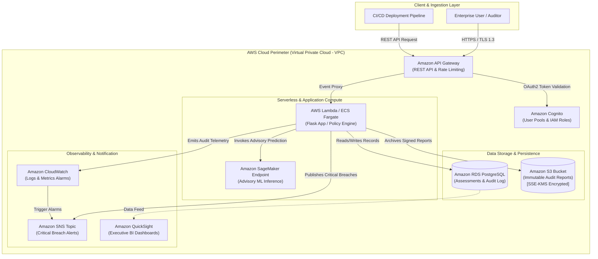

# AWS Enterprise Architecture & Cloud Deployment Plan

## 1. Executive Summary & AWS Service Mappings

SovereigntyAI is architected as a modular, cloud-ready compliance platform designed for seamless transition from local development into production on **Amazon Web Services (AWS)**. The table below details the role, service mapping, and local fallback abstraction for every component:

| AWS Service | Architecture Role | Production Cloud Purpose | Local Prototype Fallback |
| :--- | :--- | :--- | :--- |
| **Amazon API Gateway** | Edge Ingestion & API Management | Restful API routing, API rate limiting, TLS termination, and request throttling. | Built-in Flask WSGI server routes (`/api/*`). |
| **AWS Lambda** | Serverless Policy Evaluation | Event-driven, auto-scaling execution of `policy_engine.py` on S3 object uploads or CI/CD commits. | Python in-process execution via `PolicyEngine.evaluate()`. |
| **Amazon RDS (PostgreSQL)** | Persistent Compliance Datastore | Multi-AZ relational storage for assessments, compliance histories, and immutable audit trails. | Local SQLite database (`data/sovereignty_ai.db`) with identical relational schema. |
| **Amazon S3** | Audit Archive & Policy Repository | Versioned, tamper-evident storage for JSON audit reports, exported CSVs, and policy definitions. | Local filesystem storage abstraction in `data/s3_mock/`. |
| **Amazon SageMaker** | Machine Learning Pipeline | Hosting model endpoints for inference and scheduled automated retraining on new audit batches. | Local `joblib` model loading in `src/ml_model/sovereignty_risk_model.joblib`. |
| **AWS IAM** | Least-Privilege Access Enforcement | Fine-grained service execution roles, KMS key access policies, and permission boundaries. | Application configuration constants and security flags. |
| **Amazon Cognito** | Authentication & RBAC | Multi-user federated identity, OAuth2 / OIDC authentication for compliance officers and auditors. | Session-based academic authentication layer. |
| **Amazon CloudWatch** | Observability & Telemetry | Centralized log groups for application trails, alarms on policy violation spikes, and custom compliance metrics. | Console stdout logging and local metric formatting in `src/aws/aws_services.py`. |
| **Amazon SNS** | Compliance Breach Notifications | Immediate pub/sub broadcast of critical compliance failures to DevOps and legal security teams. | Simulated local console notification logger in `SNSComplianceNotifier`. |
| **Amazon QuickSight** | Business Intelligence & Reporting | Executive dashboards visualizing fleet-wide compliance posture, jurisdiction trends, and risk distributions. | Built-in interactive HTML/CSS dashboard with live distribution bars. |

---

## 2. AWS Target Architecture Diagram



---

## 3. Data Flow & Security Boundaries

1. **Isolation in VPC:** All compute resources (Lambda / ECS) and databases (RDS) execute inside private subnets across multiple Availability Zones, isolated from the public internet via AWS NAT Gateways.
2. **Cryptographic Protection at Rest:** S3 audit buckets and RDS instances are enforced with customer-managed keys (CMKs) in **AWS Key Management Service (AWS KMS)**. Cross-region replication must be configured with separate region-specific KMS keys.
3. **Data Transit:** Strict TLS 1.3 encryption is enforced at the API Gateway boundary. Internal microservice traffic between Lambda, SageMaker, and RDS remains encapsulated within VPC endpoints (AWS PrivateLink).
4. **Non-Repudiation Audit Trails:** S3 bucket object locking (WORM - Write Once, Read Many) ensures that evaluated compliance reports cannot be deleted or altered post-assessment.

---

## 4. AWS Deployment Plan & Prerequisites

### Prerequisites
- Active AWS Account with Administrative Access.
- AWS CLI v2 installed and configured (`aws configure`).
- Terraform v1.5+ or AWS CloudFormation.
- Domain name and ACM SSL/TLS Certificate for API Gateway.

### Step-by-Step Provisioning Guide

#### Step 1: Network & VPC Setup
```bash
# Create dedicated SovereigntyAI VPC with 2 Public and 2 Private Subnets
aws ec2 create-vpc --cidr-block 10.0.0.0/16 --tag-specifications 'ResourceType=vpc,Tags=[{Key=Name,Value=SovereigntyAI-VPC}]'
```

#### Step 2: KMS Cryptographic Key Provisioning
```bash
# Provision Customer-Managed KMS Key for Audit Encryption
aws kms create-key --description "SovereigntyAI Primary Compliance Key" --tags TagKey=Project,TagValue=SovereigntyAI
```

#### Step 3: S3 Audit Bucket Creation & Policy Lockdown
```bash
# Create encrypted S3 report bucket with block public access
aws s3api create-bucket --bucket sovereignty-ai-audit-reports-$(aws sts get-caller-identity --query Account --output text) --region eu-central-1
aws s3api put-public-access-block --bucket sovereignty-ai-audit-reports-$(aws sts get-caller-identity --query Account --output text) \
  --public-access-block-configuration "BlockPublicAcls=true,IgnorePublicAcls=true,BlockPublicPolicy=true,RestrictPublicBuckets=true"
```

#### Step 4: Containerize and Deploy to AWS Lambda / ECS
```bash
# Build Docker image and push to Amazon ECR
docker build -t sovereignty-ai .
aws ecr get-login-password --region eu-central-1 | docker login --username AWS --password-stdin $(aws sts get-caller-identity --query Account --output text).dkr.ecr.eu-central-1.amazonaws.com
docker tag sovereignty-ai:latest $(aws sts get-caller-identity --query Account --output text).dkr.ecr.eu-central-1.amazonaws.com/sovereignty-ai:latest
docker push $(aws sts get-caller-identity --query Account --output text).dkr.ecr.eu-central-1.amazonaws.com/sovereignty-ai:latest
```

---

## 5. Least-Privilege IAM Policy Definition

```json
{
  "Version": "2012-10-17",
  "Statement": [
    {
      "Sid": "AllowS3AuditArchival",
      "Effect": "Allow",
      "Action": [
        "s3:PutObject",
        "s3:GetObject",
        "s3:ListBucket"
      ],
      "Resource": [
        "arn:aws:s3:::sovereignty-ai-audit-reports-*",
        "arn:aws:s3:::sovereignty-ai-audit-reports-*/*"
      ]
    },
    {
      "Sid": "AllowSNSPublishAlerts",
      "Effect": "Allow",
      "Action": [
        "sns:Publish"
      ],
      "Resource": "arn:aws:sns:*:*:SovereigntyAlerts"
    },
    {
      "Sid": "AllowCloudWatchTelemetry",
      "Effect": "Allow",
      "Action": [
        "logs:CreateLogGroup",
        "logs:CreateLogStream",
        "logs:PutLogEvents",
        "cloudwatch:PutMetricData"
      ],
      "Resource": "*"
    },
    {
      "Sid": "AllowKMSKeyUsage",
      "Effect": "Allow",
      "Action": [
        "kms:Encrypt",
        "kms:Decrypt",
        "kms:GenerateDataKey"
      ],
      "Resource": "arn:aws:kms:*:*:key/*"
    }
  ]
}
```

---

## 6. Estimated Monthly Cloud Cost Breakdown (AWS eu-central-1)

For an educational or production pilot evaluating approximately 5,000 assessments per month:

| Service | Configuration Tier | Estimated Monthly Cost (USD) |
| :--- | :--- | :--- |
| **AWS Lambda** | 10,000 invocations, 512 MB memory, 200 ms duration | $0.00 (Covered by AWS Free Tier) |
| **Amazon API Gateway** | HTTP API (10,000 requests/month) | $0.01 |
| **Amazon RDS** | `db.t4g.micro` PostgreSQL, 20 GB Storage, Single-AZ | $15.50 (Free Tier eligible in first year) |
| **Amazon S3** | Standard Storage (< 1 GB audit JSONs), 5,000 PUT requests | $0.05 |
| **AWS KMS** | 1 Customer-Managed Key + 10,000 requests | $1.03 |
| **Amazon SNS** | 500 alert emails / SMS | $0.00 (First 1,000 email notifications free) |
| **Amazon CloudWatch** | 3 Custom Metrics, 1 GB Ingestion | $1.50 |
| **Total Estimated Pilot Cost** | **Fully Functional Cloud Deployment** | **~$18.09 / month** (Free tier: ~$1.10) |
