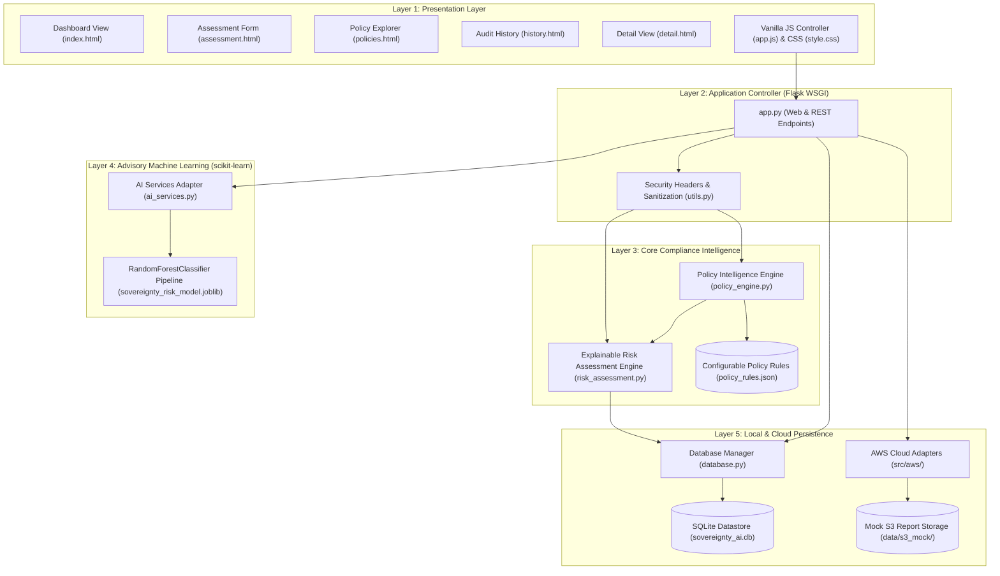
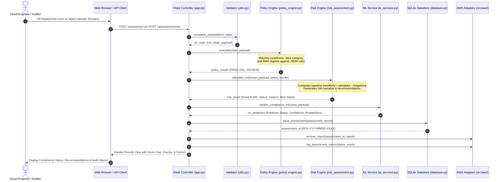

# System Architecture & Component Design

## 1. Architectural Philosophy

SovereigntyAI is built on three core software engineering principles:
1. **Decoupled Modularity:** The policy evaluation engine, explainable risk scoring algorithm, database persistence, and user interfaces are isolated into separate modules with minimal inter-dependencies.
2. **Determinism over Stochasticity:** Compliance decisions are driven strictly by deterministic statutory condition trees rather than probabilistic generative AI, preventing hallucinations and ensuring legal repeatability.
3. **Defense-in-Depth Observability:** Every evaluation produces an itemized mathematical audit trail, an advisory ML comparison, and an immutable log entry.

---

## 2. Multi-Layer System Architecture Diagram

---

## 3. End-to-End Evaluation Sequence Diagram

---

## 4. Component Directory & File Responsibility Mapping

- `app.py`: Central routing, error handling, session management, and HTTP API delivery.
- `config.py`: Environment flags, AWS region definitions, jurisdiction dictionaries, sensitivity weights.
- `policy_engine.py`: Dynamic JSON rule parser and condition matcher evaluating statutory transfer requirements.
- `risk_assessment.py`: Deterministic score calculator (0-100), factor waterfall generator, recommendation builder.
- `ai_services.py`: Advisory inference wrapper loading the trained scikit-learn pipeline with fallback handling.
- `database.py`: SQLite connection pool, schema initialization, audit trail logger, CSV/JSON exporters.
- `utils.py`: Payload normalization, input sanitization, unique ID generation.
- `src/aws/`: Modular adapters for Amazon S3, SNS, and CloudWatch.
