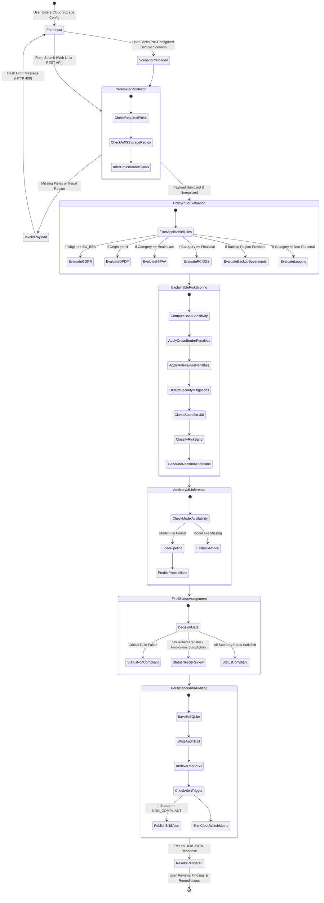

# End-to-End Compliance & Evaluation Workflow

## 1. Lifecycle Overview

The SovereigntyAI framework executes a rigorous, multi-stage compliance verification lifecycle whenever a cloud storage scenario is proposed. This workflow ensures that every configuration undergoes statutory rule evaluation, explainable risk scoring, advisory machine learning comparison, and persistent audit logging.

---

## 2. State Transition Diagram

---

## 3. Detailed Stage-by-Stage Walkthrough

### Stage 1: Ingestion & Validation
1. **Input Normalization:** `utils.normalize_payload()` receives form data or JSON API payloads.
2. **Sanitization:** Organization names, IDs, and deployment notes are stripped of unsafe HTML to eliminate cross-site scripting (XSS).
3. **Cross-Border Inference:** The system checks whether the selected AWS storage region belongs to the origin jurisdiction's native regions. If a user sets `cross_border: false` but selects an overseas region (e.g. Origin = `IN`, Target = `us-east-1`), the engine automatically corrects `cross_border` to `true` to prevent false assertions.

### Stage 2: Statutory Policy Evaluation
1. The engine iterates through the structured rule set in `policies/policy_rules.json`.
2. Non-applicable rules are assigned a status of `SKIPPED` (e.g. HIPAA checks are skipped for non-healthcare data).
3. Applicable rules are evaluated against technical and contractual parameters:
   - For GDPR: Checks for Article 45 adequacy or Article 46 Standard Contractual Clauses (SCCs).
   - For DPDP Act 2023: Checks Section 16 transfer authorizations and Section 8(5) mandatory reasonable security safeguards.
   - For HIPAA / PCI-DSS: Verifies customer-managed KMS encryption at rest, IAM least privilege, and audit logging.
   - For Secondary DR: Checks that backup regions align with the primary sovereignty domain.

### Stage 3: Explainable Risk Scoring (XAI)
1. **Base Sensitivity:** Points are assigned based on the intrinsic sensitivity of the data (Non-personal = 5, Personal = 20, Financial = 35, Healthcare/Biometric = 40).
2. **Deficiency & Breach Penalties:** Penalties are added for failed policy rules (Critical = +30, High = +20, Medium = +10) and missing security controls (Plaintext = +15, Missing RBAC = +10, Disabled Logging = +8).
3. **Mitigation Credits:** Subtractions are credited for defense-in-depth safeguards (KMS Encryption = -10, Access Control = -8, Audit Logging = -7).
4. **Floor & Clamp:** Clamped strictly between 0 and 100. If an assessment fails a critical statutory rule, a floor of 55 is enforced to ensure legal breaches are never disguised as low operational risk.

### Stage 4: Advisory Machine Learning Comparison
1. The deployment parameters are encoded into a feature vector matching the trained scikit-learn pipeline (`RandomForestClassifier`).
2. The pipeline computes class probabilities (`predict_proba`) and a predicted status.
3. The system compares the deterministic outcome with the ML output, noting consensus or explaining why the statutory rule takes precedence.

### Stage 5: Persistence & Audit Archival
1. An immutable record is created in the SQLite `assessments` table.
2. An event is recorded in the `audit_trail` table.
3. The report is serialized and archived via `s3_storage.archive_report()`.
4. Operational metrics are emitted to CloudWatch.
5. If the status is `NON_COMPLIANT`, `sns_notifier.publish_alert()` triggers an immediate breach notification.

### Stage 6: Remediation & Next Steps
1. Tailored recommendations are generated based on the specific gaps identified.
2. Step-by-step guidance is presented to the cloud engineer.
3. The assessment can be printed or exported to JSON/CSV for enterprise compliance records.
